# ВремяОбнимашки: Хранители Снов

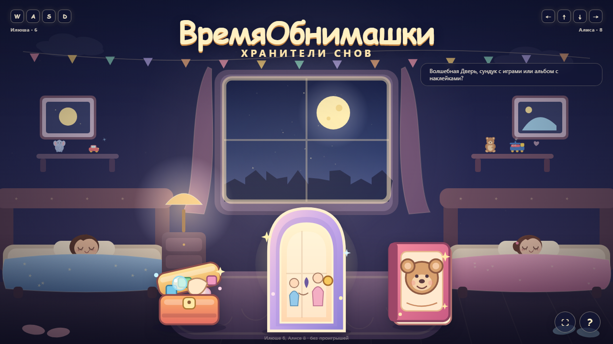

Добрая кооперативная игра для двоих на одной клавиатуре. Илюша (6 лет, младший брат) и Алиса (8 лет, старшая сестра) засыпают, а их комната превращается в Волшебную Страну Снов. Тучки-Сплюшки спрятали любимые игрушки — ребятам нужно помочь друг другу, собрать светлячков и обняться у Волшебной Двери.

Алиса старше и выше, Илюша младше и ниже — но оба одинаково смелые и важные.

**Для детей 6–8 лет. Без соперничества, таймеров и проигрышей.**

## Как запустить

1. Откройте папку с игрой.
2. Дважды щёлкните по **`Запустить игру.bat`** — игра откроется в браузере.
   Если браузер не открылся, запустите файл **`index.html`** вручную (Chrome или Edge).
3. В главном меню нажмите на **Волшебную Дверь** и выберите любой из четырёх снов.
   Сундук открывает мини-игры, а книжка с Мишкой — коллекцию наклеек.
4. Для полного экрана нажмите `F11` или кнопку **⛶** — она есть в главном меню и в игре.
   Выйти из меню можно только удержанием `Esc` в течение трёх секунд.

Интернет для игры не нужен: вся графика, музыка и звуки создаются прямо в браузере.

## Главное меню

- **Волшебная Дверь** — выбор любого из четырёх снов.
- **Сундук с игрушками** — шесть готовых мини-игр: «Радужный сон», «Лего-Башня», «Подводная охота за кляксами», «Лесной оркестр цветов», «Лесные прятки-догонялки» и «Остров Вулкана и Лавовые Мостики».
- **Книжка с Мишкой** — комната наград с наклейками за сны и мини-игры. Наведите курсор на уже наклеенную картинку в альбоме — Мама озвучит её историю. В коробочке справа подписи тоже появляются, но без голоса.
- **Лампа, окно и спящие ребята** — маленькие сюрпризы: свет меняет цвет, за окном летит звёздочка, а дети сопят во сне.
- **Голос Мамы** подсказывает при наведении на предметы.
- **Правила под рукой:** в выборе снов и в сундуке есть кнопка «📖 Как играть» — она кратко объясняет цели и управление.
- **Выход:** удерживайте `Esc` три секунды. В меню нет отдельной кнопки выхода.

## Управление

| Игрок | Движение | Действие / прыжок |
|---|---|---|
| **Илюша** (6 лет, младший брат) | `W` `A` `S` `D` | `Пробел` — фонарик/цвет, `W` или `↑` — прыжок |
| **Алиса** (8 лет, старшая сестра) | `←` `↑` `↓` `→` | `Enter` — прыжок/действие, пузыри |

- **Илюша** младший, но сильный и смелый: толкает кубики-подушки, высоко прыгает и светит волшебным фонариком. В четвёртом сне фонарик становится цветной кисточкой: `Пробел` меняет цвет луча, а прыжок — `W` или `↑`.
- **Алиса** старшая и заботливая: собирает светлячков-подсказок, выдувает огромные мыльные пузыри (зажать `Enter` рядом с целью) и помогает переносить краску в четвёртом сне.
- **Обнимашки:** встаньте рядом и зажмите `Пробел` + `Enter` одновременно. У Волшебной Двери объятия открывают следующий сон.
- **Лента дружбы** связывает ребят. Если отойти далеко, идти становится медленнее — держитесь рядом.
- **Пауза:** `Esc` или `P`.
- **Озвучка и музыка** включаются и выключаются кнопками в правом верхнем углу.

## Четыре сна

1. **Остров разбросанных носков.** Найдите фонарик, постройте мостик из кубика-подушки, разбудите нарисованную бабочку и помогите Алисе забрать ключик. В шкафу-замке ждёт Мишка.
2. **Остров потерянных деталек Лего.** Алиса находит баночку с мыльными пузырями: огромный пузырь поднимает синий кубик из ямки, а Илюша лопает его фонариком, когда деталь встаёт на место моста. Потом Алиса ловит в пузырь тучку-Сплюшку, тучка становится розовым батутом, а Илюша достаёт с крыши поезда потерянное колесо и чинит Лего-поезд. Соберите **все пять светлячков** — их ловят оба героя; без них Волшебная Дверь не откроется. Пока мост не построен, облачко возвращает упавшего назад на левый берег.
3. **Лес книжных страниц.** Прочитайте книгу снов и встаньте на нужные фигуры: Илюша — на свой цвет и форму, Алиса — на свой. Три страницы, три фонарика — и Слонёнок найдётся.
4. **Поляна гигантских книжек-раскрасок.** Мир потерял все краски. Сначала Илюша раскрашивает домик, деревья и травку в левой части поляны: деревья — зелёным, домик — жёлтым, травку — красным. Только после этого зелёный луч оживляет большое дерево и превращает его ветки в мост. Красный луч делает яблоко тяжёлым, чтобы качели-катапульта подбросили Алису к Книге Сказок. Внизу Илюша находит синюю краску, Алиса выдувает пузырь, переносит её на страницу — и Птица Счастья оживает. Остаётся запрыгнуть ей на спину и обняться.

## Мини-игра «Радужный сон»

Открывается из **сундука** в главном меню. Это дружная командная игра без соперничества: Илюша и Алиса раскрашивают большую открытку с ракетой за 5 минут.

- **Илюша:** `WASD` двигает синюю искорку, `Пробел` стреляет краской. Он отвечает за синий и зелёный.
- **Алиса:** стрелки двигают жёлтую искорку, `Enter` стреляет краской. Она отвечает за красный и жёлтый.
- **Смешивание:** наведите обе искорки в фиолетовую или салатовую зону и нажмите `Пробел` + `Enter` вместе. Синий + красный дают фиолетовый, зелёный + жёлтый — салатовый. За такие зоны дают в два раза больше очков дружбы.
- **Тучки-Сплюшки** иногда пролетают по открытке. Попадите в тучку краской — она лопнет конфетти и добавит **+5 секунд**.
- В конце картинка оживает: ракета поднимается, а на экране появляется золотое сердечко-медаль. Разбейте его совместным нажатием `Пробел` + `Enter` — и праздничная наклейка «Радужный сон» отправится в альбом.
- Если раскрашено больше половины, Мама хвалит художников; если вся открытка — называет ребят самой дружной командой.
- Вернуться в меню можно стрелкой в левом верхнем углу или клавишей `Esc`.

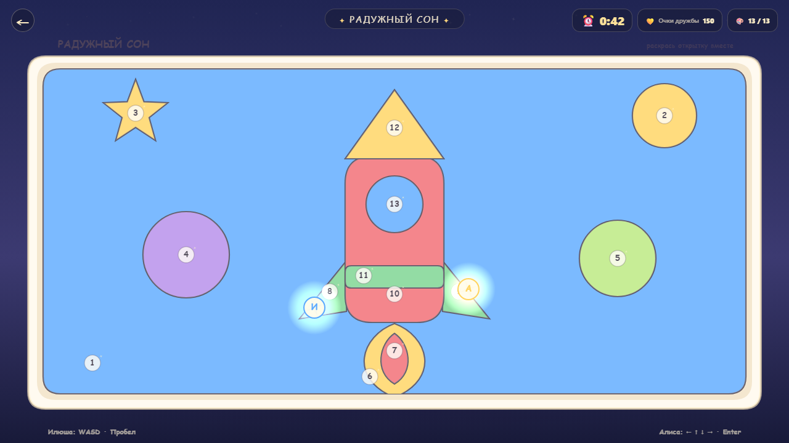

## Мини-игра «Лего-Башня»

Открывается из того же сундука. Это командная стройка: за 5 минут нужно построить как можно более высокую башню, чтобы Мишка добрался до звёздочки.

- **У обоих игроков** в наборе есть тяжёлые блоки, крыши, шпили и флажки. Илюша берёт деталь `Пробелом`, Алиса — `Enter`; несите её к башне, прыгните и отпустите кнопку.
- **Порядок стройки:** сначала вместе сложите фундамент из **5 тяжёлых блоков**, потом поставьте **крышу**, затем **шпиль** и **флажок**.
- **Каждый тяжёлый блок — один этаж.** На части этажей появляются окна. Высота показывается в этажах.
- Когда стоят крыша, шпиль и флажок, стройка **сразу завершается**: Мишка поднимается к звёздочке, а дети обнимаются.
- Если положить тяжёлый блок поверх крыши или шпиля, он **сбросит украшения** и встанет на их место. Придётся снова поставить крышу и верхушку.
- Мама комментирует высоту каждые 9 этажей: на 9 — «Это высотный дом!», на 18 — «Это супервысотка!», на 27 — «Это башня-великан!», на 36 — «Это небоскрёб!».
- **На 40-м этаже башня разваливается**, все блоки падают, и строительство начинается заново. Таймер при этом продолжается.
- В финале Мишка карабкается по кубикам, хватает звёздочку, а Илюша и Алиса встречаются на вершине. Зажмите `Пробел` + `Enter` для обнимашек.
- За прохождение открывается наклейка **«Лего-Башня»** в альбоме.
- Вернуться в меню можно стрелкой в левом верхнем углу или клавишей `Esc`.

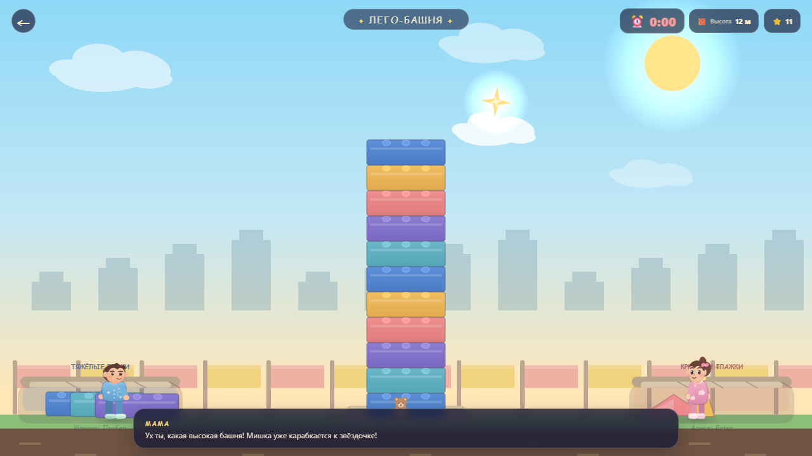

## Мини-игра «Подводная охота за кляксами»

Открывается из сундука. Илюша и Алиса в масках для плавания ныряют в Волшебный Океан Снов, который Каракатица-Сплюшка испачкала чёрными кляксами. Нужно очистить океан и вернуть рыбкам цвета.

- **Илюша:** `A`/`D` — плыть влево-вправо, `W` — прицелиться вверх-влево, `S` — вверх-вправо, `Пробел` — выстрелить синим водяным шаром.
- **Алиса:** `←`/`→` — плыть, `↑` — прицелиться вверх-влево, `↓` — вверх-вправо, `Enter` — выстрелить розовым шаром.
- Попадание по кляксе лопает её яркими брызгами. Брызги окрашивают серых рыбок, и они приносят сердечки дружбы.
- В океане плавают **12 рыбок**: восемь круглых и четыре необычных — **карасик, щука, рыбка-ангел и рыбка-меч**.
- Раскрашенные рыбки не исчезают: они остаются плавать по рабочему полю и радостно машут плавниками.
- Если Илюша и Алиса одновременно попадут в одну кляксу, получится **Радужный Мега-Шар**: он очищает все кляксы на экране.
- Вверху заполняется шкала-радуга. Когда спасены все рыбки, океан снова сияет, а дети обнимаются нажатием `Пробел` + `Enter`.
- За прохождение открывается большая наклейка **«Радужная рыбка»**.

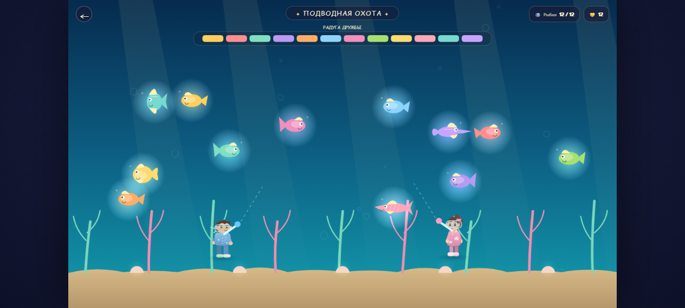

## Мини-игра «Лесной оркестр цветов»

Ночная Поляна Поющих Деревьев уснула под серым туманом. Илюша и Алиса берут волшебные деревянные духострелы и будят цветы светящимися семенами.

- **Илюша:** `W`/`S` — вверх-вниз по лесенке, `A`/`D` — наклон трубочки выше-ниже, `Пробел` — синее семечко.
- **Алиса:** `↑`/`↓` — вверх-вниз по лиане, `←`/`→` — наклон трубочки, `Enter` — розовое семечко.
- Попадание в серый бутон раскрывает цветок, возвращает ему краску и добавляет ноту в лесную мелодию.
- Семечко, попавшее в уже раскрытый цветок, **отскакивает вверх** и может разбудить ещё один бутон выше.
- Если до дальнего цветка не достать, стреляйте **вниз в светящуюся лужайку**. Семечко отскочит вверх, а лужайка на мгновение зажжёт ковёр из мелких цветочков.
- В центре — **Главный Бутон**. Если Илюша и Алиса попадут в него одновременно, распустится золотая кувшинка, а волна пыльцы раскроет цветы только в **ближнем круге**. Остальные бутоны нужно разбудить семечками.
- Когда расцвели все **16 цветов**, дети встречаются на мостике, обнимаются `Пробелом` + `Enter`, а наградой становится наклейка **«Лесной оркестр»**.

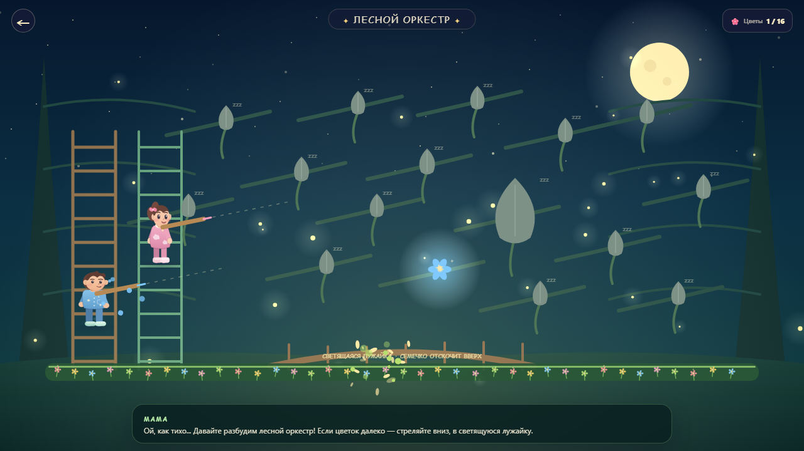

## Мини-игра «Лесные прятки-догонялки»

Весёлая погоня на солнечной лесной поляне. Два раунда по 60 секунд: сначала водит Илюша, потом Алиса. Деревья, ёлки, валуны и кусты помогают прятаться и петлять.

- **Илюша:** `W`/`A`/`S`/`D` — бег, `Пробел` — невидимость.
- **Алиса:** стрелки — бег, `Enter` — невидимость.
- Невидимость длится **3 секунды**, затем звезда перезаряжается **7 секунд**.
- Водящий ловит убегающего; за поимку он получает звёздочки радости. Если время вышло, звёздочки достаются убегающему.
- На тропинках появляются бонусы: земляничка-скороходка (ускорение втрое), мухомор-пружинка, сонная шишка (сильное замедление соперника) и светлячки. Каждый светлячок увеличивает время невидимости: ×2, ×3 и дальше.
- Запас невидимости обоих игроков показан на двух шкалах над поляной.
- После двух раундов звёздочки складываются в общую копилку, дети обнимаются, а наградой становится наклейка **«Зайчик-попрыгунчик»**.

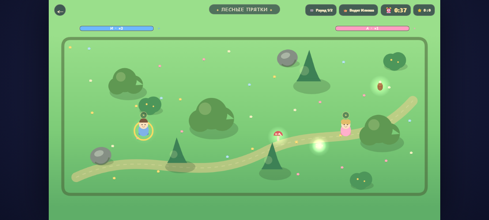

## Мини-игра «Остров Вулкана и Лавовые Мостики»

Весёлая аркадная стройка на склоне Кубического Вулкана. Снизу поднимается сладкая карамельная лава, а Илюша и Алиса строят путь к вершине и большому Воздушному Шару.

- У героев **одинаковые возможности**: бег, прыжок, добыча блоков коротким нажатием и строительство удержанием кнопки.
- С построенных мостиков можно **спрыгнуть вниз** клавишей `S` или `↓`.
- Вместе они строят **Супер-Мосты**, когда ставят блоки по очереди. Над первым шаром такие мостики автоматически получают дополнительные блоки.
- Выше первого шара готовых мостиков нет: дети сами строят путь из добытых блоков на ту высоту, на которую хватит запасов. В пустоте между шарами висят **неподвижные маленькие звёздочки и облачка** — по ним видно, как летающие мостики движутся вверх и вниз.
- Запас блоков ограничен: у каждого героя **2 стартовых блока**, а разрушаемых блоков на склонах стало вдвое меньше.
- Есть **два летающих мостика — для Илюши и Алисы**: встаньте на свой и управляйте им клавишами движения. `Пробел`/`Enter` взрывает мостик, и герой падает на ближайшую опору.
- Вулкан высотой 50 этажей; на **высоте 50** появляется **второй Воздушный Шар**, на котором тоже можно улететь.
- На второй зелёной платформе ждёт **летающий звездолёт для двоих**: он летает влево-вправо и вверх-вниз, звёздочки при приближении светятся и улыбаются, а тёмные блоки взрываются. После всех звёздочек звездолёт может спуститься к самой лаве. `Пробел`/`Enter` сажает звездолёт или сбрасывает подобранные блоки; упавший блок взрывает мостик или останавливает и отодвигает лаву на 3 секунды.
- На склонах встречаются **желейные батуты**, **сладкий лёд**, **зефирные лифты**, **попкорн-хлопушки** и **магнитные кристаллы**.
- Если кто-то влип в карамель, второй может вытащить его, а через пару секунд лава сама вытолкнет героя на ближайший блок.
- В корзине шара нужно зажать `Пробел` + `Enter` — и шар унесёт ребят в небо.
- Проигрыша нет; наградой становится наклейка **«Воздушный Шар»**.

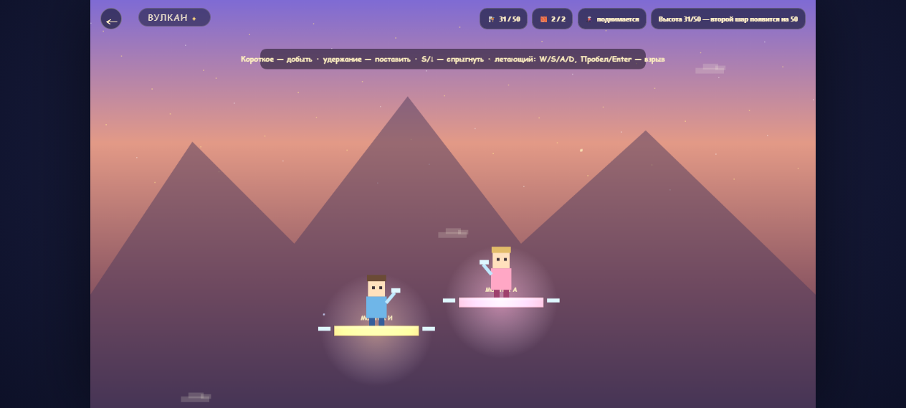

## Для родителей

- **Нельзя проиграть.** Если персонаж оступится, доброе облачко подхватит его и вернёт на мягкий пол.
- **Нет рекламы, покупок и сбора данных.** Игра работает локально.
- **Прогресс сохраняется** в браузере: пройденные сны отмечаются звёздочками, а заработанные наклейки — за сны и мини-игры — остаются в альбоме.
- **Голос.** Игра пытается использовать русский голос браузера для реплик. Если голосовой движок недоступен, все реплики остаются в красивых субтитрах. Озвучку можно отключить кнопкой-динамиком.
- **Совет.** Играйте вдвоём за одной клавиатурой: так проще обниматься и слышать друг друга.

## Скриншоты

| Сон 1 | Сон 2 |
|---|---|
| 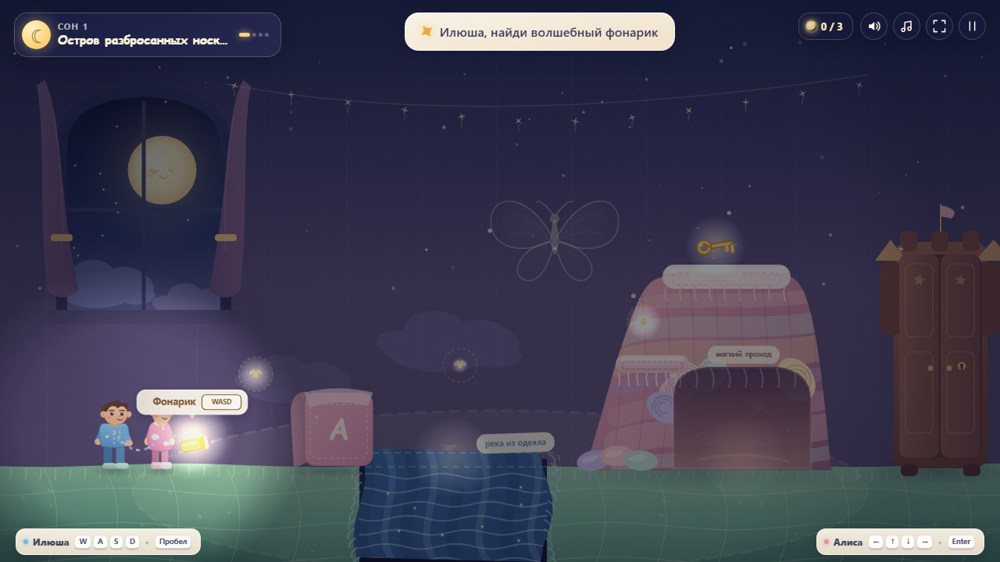 | 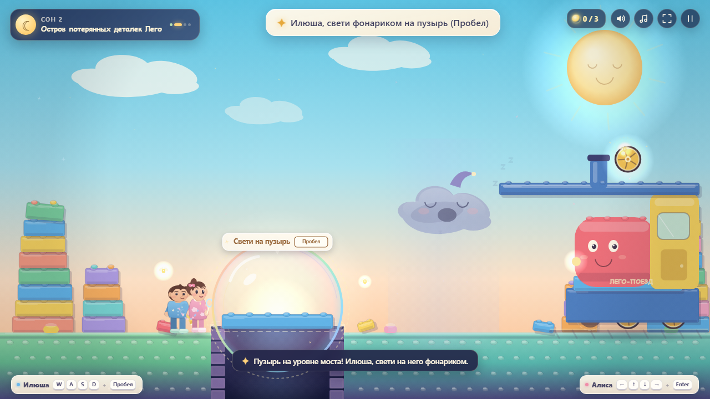 |

| Сон 3 | Сон 4 |
|---|---|
| 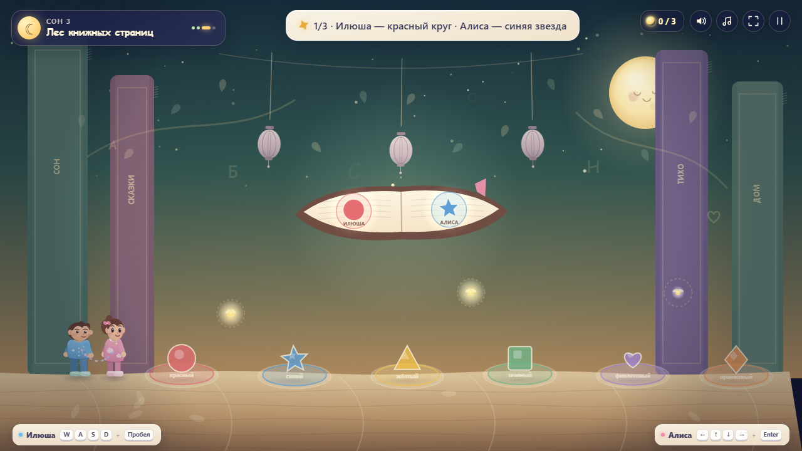 | 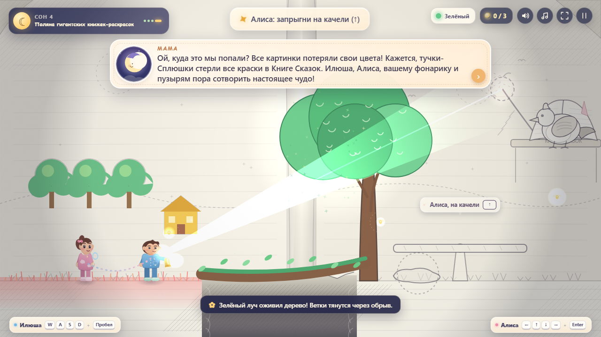 |

| Финал |
|---|
| 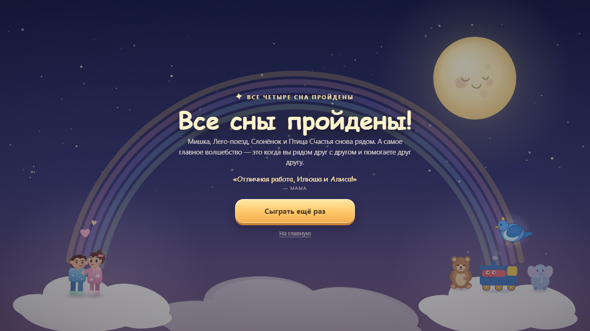 |

| «Радужный сон» |
|---|
|  |

| «Лего-Башня» |
|---|
|  |

| «Подводная охота за кляксами» |
|---|
|  |

| «Лесной оркестр цветов» |
|---|
|  |

| «Лесные прятки-догонялки» |
|---|
|  |

| «Остров Вулкана и Лавовые Мостики» |
|---|
|  |

| Наклейки с подсказками |
|---|
| 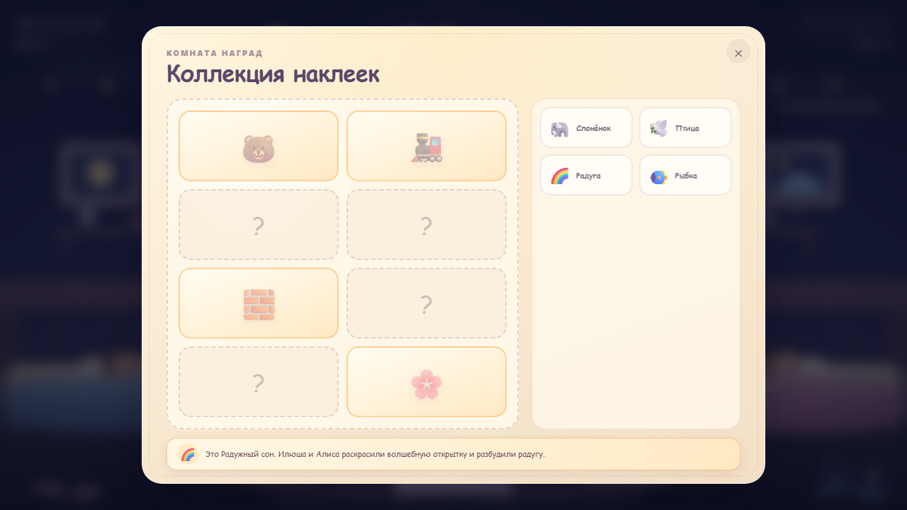 |

| Правила мини-игр |
|---|
| 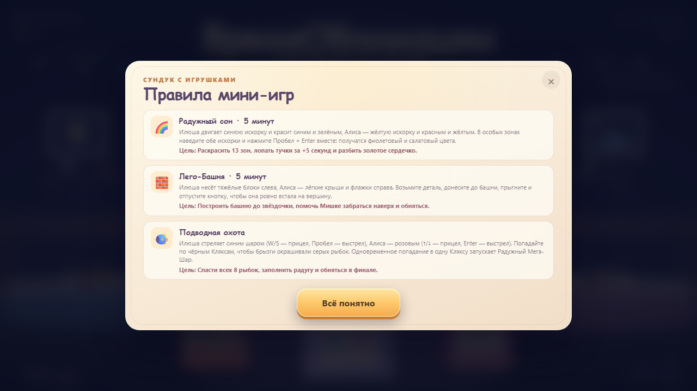 |

## Технические детали

- HTML5 Canvas + JavaScript, без внешних библиотек и файлов ассетов.
- Вся графика нарисована кодом, музыка и звуки синтезируются через Web Audio API.
- Голосовые реплики — через `speechSynthesis` (если в системе есть русский голос).
- Поддерживаются современные Chrome и Edge. Рекомендуется полноэкранный режим.

Приятных снов и обнимашек! ♡
